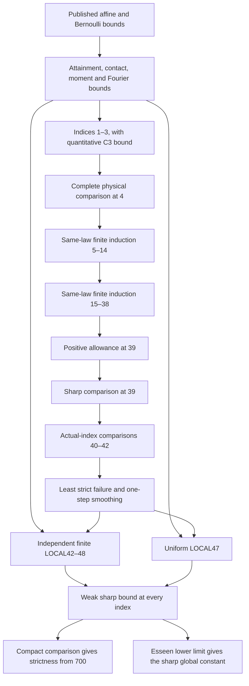

# Dependency map for the extension

The extension proves the sharp weak inequality at every index and strictness
from700. All required selected numerical families and their complete interface
readers have passed. The mathematical status is a locally derived and checked
computer-assisted proof, using the named published inputs; the execution
status is completed selected native verification. These remain separate
judgments: no program below proves the continuous reductions automatically.
The LaTeX labels below identify statements independently of pagination.

The arrows from the least-failure node to the local exclusions mean that its
quantitative conclusions satisfy their hypotheses. Neither local exclusion
uses the all-index conclusion. The four finite bands in the diagram abbreviate
ordinary induction in the actual integer n, not a transfer of C_n monotonicity.

| Node | Precise conclusion and mathematical inputs | LaTeX proof | Execution status |
|---|---|---|---|
| Attainment/contact | For each fixed n≥2, C_n is attained by a compactly supported positive closed-CDF ratio maximizer; contact is at coefficient c=C_n. Fixed-target attainment also holds for any c>0. | `v9:core:attainment`, `ext:ratio-attainment` | Continuous proof; no numerical premise |
| Indices 1–3 | C1≤2/5, C2≤2√2/7, C3≤59√3/250<CE. Affine moment caps and contact precede the supported tensor majorants. | `ext:n123`, `ext:n23-contact` | All complete native checks fresh PASS, plus independent n2 checker and negative controls |
| Index 4 | The supported physical comparison bounds the score by4097/10000. Its unrestricted application uses the proved quantitative C3 bound, contact, the acquired support/rho/beta/w region, and all260 parent dispositions. | `ext:n4-localization`; Appendix “The four-summand physical comparison” | Fresh full recomputation and complete admission PASS:260closed parents,1300HIGH request slots fully accounted (1002direct HIGH calls),662LOW calls, zero unresolved;22new rejection controls. No missing producer exit or second completed pass claimed |
| Index 5 | Sharp C4 plus actual-n support, supported/unrestricted Fourier estimates,12 initializer/resource families,295 COUNT forests, the separate signed corner and six complementary Fourier bands imply C5≤CE. | `ext:finite-five-fourteen`; `sections/06i-five-summand-assembly.tex` | All31 parents and326-frame same-law assembly PASS:12 regions,70 closed signed arrangements,295 forests/75178 leaves,20 final mutations and6 COUNT provenance controls. Five memory-only retries use explicitly named V3 transport. ROOT4 ancestor is now discharged |
| Indices 6–14 | Inductively C_(n−1)≤CE<C_n makes the same-law predecessor loss nonpositive. Actual support licenses the Fourier inputs, which license INITIAL, resource and COUNT in that order. All moment and probability seams are closed. | `ext:finite-five-fourteen-assembly`, `ext:finite-acquisition` |All51 actual-index support rows exactly re-evaluated; all13 INITIALs, owncaps344 rows, core10–14 forty actions, Fourier complements and resource families passed. Complete same-law joins cover2200 closed panels with501 forests/414800 leaves; both final semantic joins and the full acquisition reader independently read back, with all rejection controls passed |
| Six sign panels at6 | For each sign, ρ²P(±X>0)≥8(7√7−17)/27>11261/25000. This rules out the six explicitly listed whole panels, including zero-atom laws. | `ext:sign-mass-bound` | Continuous proof independently derived; exact constants fresh PASS |
| Indices15–38 | Same-law induction, actual support, Fourier complements, complete acquisition/resource and COUNT domains. For n≥25 one-step smoothing supplies the loose scalar ceilings. | `ext:finite1539-assembly`, `ext:first-failure25` | All15–34 numerical roles complete:10 low-moment15–19 cases (147 forests/56966 leaves/1000 panels), high-rho14–19 (49strips/294actual-index rows), actual20–24,25 selected B0/B1 and weighted26–34 joins. All35–39 INITIAL/resource parents and120 forests/120618 leaves joined over500 closed panels; no open15–39 numerical gate |
| Floor transfers25/31 | For actual n≥N, retain raw remainder≤r and nD≤Nd at every pass. Support is separately established at the actual index; binomial probabilities retain actual n. | `ext:finite-floor-transfer` | Continuous direction checks read; full weighted26–30 and31–34 domain joins PASS |
| Five omitted26–30 B0 panels | D≤25d/n contradicts the acquired binary charge on(27,53),(28,53),(29,53),(30,52),(30,53). A two-row rational bound proves all five exclusions including endpoints. | Section “The finite induction from fifteen to thirty-nine”, paragraph “Five panels excluded” | Root exact checks/8controls and independent bridge derivation PASS; complete500-panel/80-forest weighted join PASS |
| Second-band26–30 sine inputs | The simultaneous floor intercepts satisfy d−b=g*d0=h*L. The weighted plane gives (n/25)delta/d0+lambda_n/L≤1, hence lambda_n≤1/(L^−1+(25B*d0)^−1). This licenses the common pair-square/support constants on all55 scopes. | Appendix “Finite-frequency sine bounds”, paragraph “A direct resource-to-sine map” | Fresh full parent/support readback, independent55-scope check/10controls, and full115 Fourier rows in two passes PASS |
| Positive39 | From sharp predecessors and first-failure entry, the K=741/4000 local calculation excludes39(C39−CE)≥K; hence C39<41449/100000. This is a prerequisite of the selected sharp39 INITIAL. | Appendix “The fixed-index positive allowance at39” | Nine native actions and full277-closed-subinterval join PASS;11 controls and independent review |
| Sharp39 | Uses the just-proved own-score cap, actual support and its own acquisition/resource/COUNT family. | `ext:finite1539-assembly` | All actual35–39 parents and full500-panel/120-forest join PASS; the separate positive39 prerequisite is already discharged |
| Indices40–42 | At a first failure, both deleted constants≤CE, excess<0.3/n, own score<0.4226 and loss zero. Weighted floor40 estimates, actual-index binomial slack and the complete signed cover exclude it. | `ext:floor40` | All4 branches,152 LOW rows/304 native observations and22 exact input joins recovered; two fresh complete binders and4 controls PASS |
| Finite LOCAL42–48 | No n∈[42,48] can satisfy0<n(C_n−CE)≤0.54, n(C_(n−1)−C_n)_+≤0.19, C_n<0.4226 and both deleted constants<0.4253. | `ext:local42-input`, `ext:local-engine`, local-estimates appendix |All171 tasks complete:170 preserved full admissions plus fresh central binder (19,842,356 strict gates);184-cell closed probability cover,25mathematical and2recovery controls PASS |
| Uniform LOCAL47 | The analogous conjunction for every n≥47, with excess≤0.7 and own score<0.4247, is impossible. It uses uniform analytic index bounds, not an extrapolation from n≤98. | `ext:local47-input`, `ext:local-engine`, local-estimates appendix | Original14+41 suite fully recovered with unchanged complete mathematical reader;7 negative controls PASS |
| Weak all-index bound | Sharp1–42 plus the two local exclusions imply C_n≤CE for every n≥1. At the least strict failure≥43, smoothing gives excess<3003/10250, own score<73/175, zero loss and sharp deleted predecessors. | `ext:bridge-composition` | All prerequisites discharged: finite induction through42 and both local exclusions are complete; the first-failure composition proves the weak all-index bound |
| Strict tail | The weak all-index result supplies the predecessor bound for the compact fixed-target exclusion at every n≥700, including equality. | `short:acquired-exclusion`, `short:global` | Retained compact entry/scalar checks reproduced and source-bound; proved weak all-index bound supplies the predecessor; equality is excluded by attained fixed-target comparison |
| Global sharp constant | Weak all-index upper bound plus Esseen's fixed skew-Bernoulli lattice limit gives sup_n C_n=CE. | `ms:bernoulli-limit` and final composition | Upper-bound dependencies complete; fixed skew-Bernoulli Esseen limit supplies the matching global lower bound |

## Execution records and their meaning

The fresh1,243-job public COUNT batch is complete: no failures, no saved PASS
reused. Its inputs are supplied untrusted certificates. Their generation was
not repeated in that campaign; their complete original arithmetic acceptance
was. This is sufficient for the numerical conclusions once the analytic
domains and same-law inputs are established.

The current26–39 family uses300 complete forests.146 supplied objects differ
from the older source catalog. The new descriptor epoch changes only their
candidate identities and reconstructed tree/census statistics; the mathematical
sources, targets and contracts remain fixed.134 public source capsules also
contain explicitly identified unused discovery files, whose namespace mapping
is now recorded. No discovery-only source supplies a numerical proof claim.
The complete native replays and reconstructed closed trees cover371882 leaves.
Resource-to-COUNT implications remain a separate obligation.

The reproduction package identifies the completed source/capture
readbacks for every row above. A hash establishes byte identity; a success
word establishes nothing without its verified complete result and applicability.
The Python programs do not prove the continuous lemmas, and the continuous
lemmas do not assert the outcome of an unfinished numerical run.

## Scope that is not claimed

The extension proves C_n≤CE for all n, with the retained strict result from700.
It does not claim exact two-point optimality for every sufficiently large n,
strictness at every smaller index, or formal verification in a proof assistant.

The final numerical records are linked in `reproduction/EVIDENCE.md` and
`reproduction/COMPLETION_LEDGER.json`. The separate114-command fresh recipe
is not claimed to have been rerun as one relocated campaign. The full native
records retain each actual execution identity and every selected failed or
interrupted attempt; no missing outer exit is fabricated.
