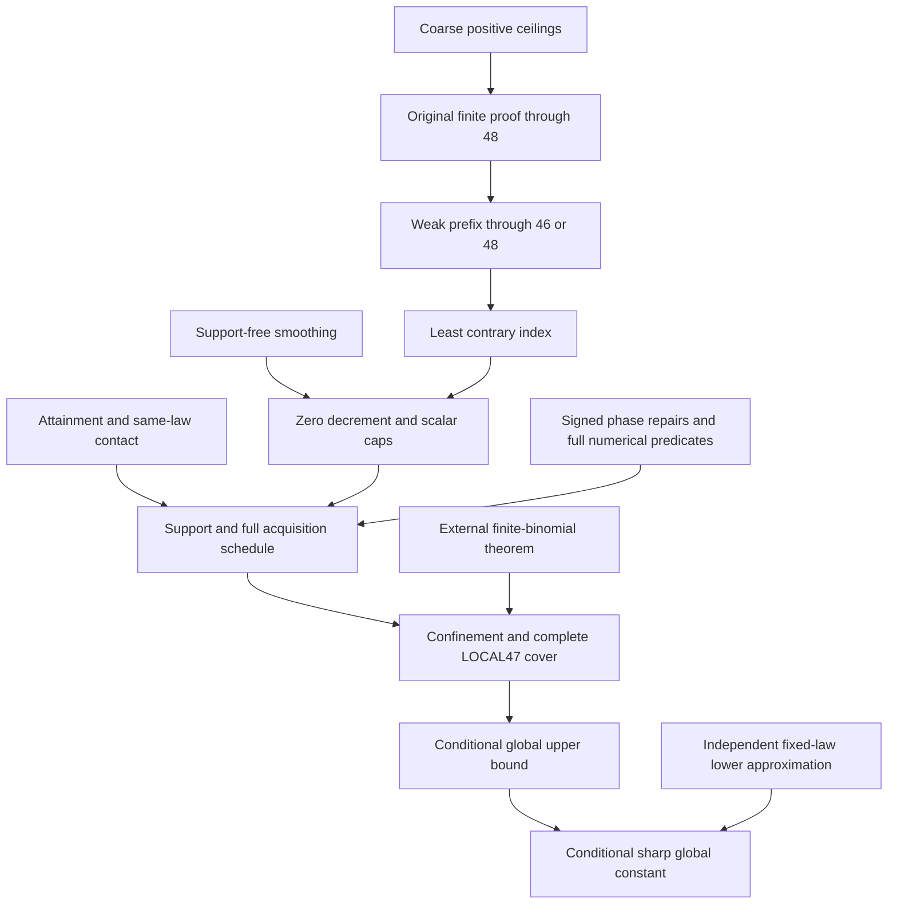

# Least-counterexample dependency audit

Date: 27 October 2026. Review baseline: `6346fc1b4432bc5982822aa696eb566ed9e1e1ee`
in [kolodziejek/berry-esseen-certificates](https://github.com/kolodziejek/berry-esseen-certificates).
The local tag `audit-baseline-20261027` preserves that commit. The audit and
three independent investigations use separate branches/worktrees. This change
adds review material only; existing theorems, certificates, manifests and
controllers retain their baseline bytes.

## Verdict

The proposed scalar argument is valid. Its smoothing inequality also has a
direct proof using only the third absolute moment. A weak finite base through
46, together with the **existing full conditional LOCAL47 implication**, would
give the global weak sharp bound without the independent strong-46 / three-loss
bootstrap. The equality-compatible version of LOCAL47 even gives a separately
stated strict tail from 47. These are conditional composition results, not a
fresh proof of the Berry--Esseen conjecture or of the numerical LOCAL47 premise.

The conditional computational saving is narrower than the roadmap might suggest:
the dedicated strong-46 support/barrier calculations are candidates for bypass
in a new global assembly. The coarse ceiling branch still has a finite43--48
consumer. There are no separate per-index 47 and 48 task families to discard:
the finite program shares acquisition and floor42 LOW calculations across the
range. Phase corrections, support acquisition and the full LOCAL47 comparison
remain required. **No existing computation or certificate is approved for deletion.**

The baseline's public full proof is conditional: `paper/main.tex:54–61` assumes
the thirteen numerical families; `README.md:22–34` explicitly withholds a
complete public end-to-end `full_pass`. The present audit does not discharge
those predicates. Some final provider implementations named in the global
contract are not tracked under their listed filenames in this commit. Their
possible presence in other content-addressed archives remains unresolved; their
hashes are not substitutes for inspection.

## Evidence and limits

| Result | Mathematical status | Execution status |
|---|---|---|
| Gaussian conditioning / heat smoothing recurrence | Locally derived and independently checked; every standardized iid law, finite third absolute moment, every integer n >= 2 | New small exact constant checks only; no certificate campaign |
| First-violation scalar caps at n >= 47 | Locally derived and independently checked | Fresh rational checks; see scalar review and run receipt |
| Replacement of independent tail assembly by finite-prefix composition | Conditional on a genuine finite base and all retained LOCAL47 analytic/numerical premises | New scalar checks only; revised production assembly not implemented |
| Fixed-index attainment/contact and qualitative bounded support | Continuous proof read and checked at the interface used here; see `paper/main.tex:102–171` | No numerical execution needed for this derivation |
| All-index acquisition, confinement and local exclusion | Supplied proof candidates; exact interfaces and selected source paths audited below; complete numerical conditions retained | Native acceptance not rerun in this audit; earlier records remain historical evidence |
| Finite base 1–46 (or conservatively 1–48) | Conditional on its original analytic reductions and complete numerical predicates | No full base replay in this audit; public final finite collectors remain incomplete |
| Published finite-cap, smoothing-kernel and Bernoulli inputs | External theorem inputs at their cited scopes; not newly verified from original publications in this audit | Not run |
| Complete global theorem / formalized analytical proof / compressed certificate block | Not established by this change | Not run / not attempted |

The full new scalar proof is also supplied as [LaTeX](scalar-proof/main.tex) and a
[three-page PDF](scalar-proof/main.pdf), with [render verification](scalar-proof/verification.json).
The supporting reports are [scalar review](scalar-review.md),
[acquisition review](acquisition-review.md), and
[computation review](computations-review.md). Source integrity pins are in
[baseline.json](baseline.json). An independent reviewer derived the scalar
argument without assuming the roadmap's calculation. The coordinator read the
displayed proofs and the archived entry and local-exclusion statements directly.
Agreement between reviewers is not a proof, and no new scalar or inventory PASS
is interpreted as a native certificate PASS.

The subsequent [independent review](reviews/REVIEW.md) is complete with no
blocking findings for this audit-only change. It checks component integration,
independently rederives the scalar argument, and cross-checks the acquisition
interfaces and shared computation consumers. The audit-only review additions
are recommended for merge after explicit owner approval. PR #1 was merged
outside this agent's actions before the review commits were pushed; the owner
authorized a single follow-up draft. This is not acceptance of the retained
native predicates or of a production simplification.

## The precise new composition

Write c = C_E and a_n = C_n - c. Assume:

1. `BASE46`: C_j <= c for every integer 1 <= j <= 46, with its genuine proof
   dependencies, including the quantitative G3-to-G4 edge.
2. `SMOOTH`: for every integer n >= 2,
   C_n <= sqrt(n/(n-1)) C_(n-1) + sqrt(n)/(15(n-1)^(3/2))
   + 2 sqrt(n)/(25(n-1)^2).
3. `LOCAL47`: for every integer n >= 47, the simultaneous conditions
   0 <= a_n <= .7/n, n(C_(n-1)-C_n)_+ <= .19,
   C_n < .4247, and C_(n-1), C_(n-2) < .4253 are impossible.
   This abbreviation retains the full acquisition, uniformity, comparison,
   zero-noise, external-input and numerical-proof obligations audited below.

Choose the least index n with C_n > c. Then n >= 47, both predecessors
are <= c, and d_n = 0. Setting s = sqrt(n/(n-1)), SMOOTH yields

    n(C_n-c) <= n/(n-1) [c/(s+1) + s/15 + 2s/(25 sqrt(n-1))]
              < (47/46) [41/200 + 1011/15000 + 1011/75000]
              = 335909/1150000 < 3/10.

Here c < 41/100, 1 < s < 1011/1000, and sqrt(n-1) > 6 for n >= 47.
The own cap follows from c + .3/47 < .4247, and both deleted caps follow
from c < .41 < .4253. LOCAL47 contradicts the violation. This proves the
**weak** global upper conclusion, conditional on BASE46 and LOCAL47.

For a distinct **strict-tail variant**, choose the least n >= 47 with
C_n >= c. The weak base suffices at predecessors 45 and 46; predecessors
in the tail are strictly below c. The same scalar argument applies, including
d_n = 0 at equality. LOCAL47 explicitly allows a_n = 0, so it gives a
contradiction and hence C_n < c for every n >= 47. This is not a silent
upgrade of the roadmap's least-`>` argument: equality compatibility is an
additional checked interface fact. It leaves finite-base statements unchanged.

For the conservative first revision retain BASE48 intact and start the same
argument at n >= 49. The n >= 47 scalar bound remains valid. There is no
separate base49 argument and no special coarse cap for predecessor 48 at n=50.
The independent lower approximation for C_* >= C_E is unchanged.

## Exact locations and hypothesis reconciliation

Archive references below mean
`verification/finite-tail/sources/BE_cutoff49_20260930.zip`, member paths
relative to its `BE_cutoff49_20260930/` root, with one-based member line numbers.
The archive is pinned in baseline.json; no archived source was executed or edited.
The supplement's displayed “Original M...” numbers are **not** its current-file
line numbers. This audit uses current-file numbers or explicit archive members.

| Edge | Required hypotheses and how supplied | Source |
|---|---|---|
| Scalar supremum -> actual owner | Fixed n, standardized laws, finite rho; positive closed orientation, attainment also at equality. Lower semicontinuity of rho plus extremality replaces any unjustified third-moment uniform integrability. | `paper/main.tex:102–171` |
| Sharp predecessor -> same-law allowance | R_(n-1)(P) <= C_(n-1) <= c <= C_n. Thus q_n(P,C_n)=0 and d_n=0, without asserting predecessor contact or index monotonicity. | `paper/main.tex:173–196`; supplement `indcore:lem:replacement` |
| SMOOTH | Any standardized law; globally bounded Gaussian derivatives; rho >= 1. The error is uniform before taking either supremum; atoms cause no differentiation of indicators. | `paper/analytic-supplement.txt:6479–6522`; archive `paper/sections/global_route.tex:6–49` |
| LOCAL47 scalar entry | Actual n >= 47; 0 <= n a_n <= .7; d_n <= .19; own .4247 and both deleted .4253 caps. All are supplied by the calculation above. | Archive `paper/sections/global_route.tex:81–115` |
| Actual support and INITIAL | Attained contact plus scalar cap/loss premises -> full support radius 3.84, then INITIAL47. The moment resources do not acquire their own support. | Archive `paper_entry/resource_entry.tex:375–420`; acquisition review's native support rows |
| Closed acquisition schedule | I -> C/L -> C1/C2 -> S -> L2, all fields for one law and raw H. C2 confinement consumes C and then intersects C1; it does not consume its own result. Exact outward arithmetic, sign repairs and complete complements remain inputs. | Archive `paper_entry/resource_entry.tex:304–420` |
| Uniformity beyond 98 | INITIAL's apparent nmax=98 enters only the floor guard and .4095+K/98, with K=0 here. Actual-index monotonicity gates and weighted nD / n E U^2 exports remain necessary. | Archive `paper/sections/global_route.tex:107–114`; `paper_entry/resource_entry.tex:245–253,402–419`; native check in acquisition review |
| Confinement | Actual acquired panel, initial Y strip, .4<C<=.4253, signed H bounds, both deleted convolution concentration bounds, coherent strict resource budget, actual support endpoints. | `paper/analytic-supplement.txt:6529–6618`; detailed acquisition review |
| Local positive-noise exclusion | Same conditional laws U_0,U_1, interior nearest count, positive mass lower bound, all support/moment/phase/noise gates and full closed coverage. Nearest-count D>0, or whole-count B<0 and I>=0 before replacing n by its floor. | `paper/analytic-supplement.txt:7099–7201,7691–7757` |
| Zero noise and final contradiction | lambda=0 implies each conditionally centered noise vanishes; use the separate finite-binomial bound. For lambda>0 the strict negative comparison uses the same law/count/phase. | `paper/analytic-supplement.txt:7759–7770`; archive `paper/sections/global_route.tex:98–105` |

The [acquisition review](acquisition-review.md) expands the support, Fourier,
resource, signed correction, confinement and comparison subedges. None is
replaced by the new scalar calculation. Scalar q_n, global d_n, geometric
inward displacement, physical D and conditional noise lambda are distinct.

## Dependency graph and candidate removals

The old edge `coarse ceilings -> strong46 -> three losses -> base49` is absent
from this proposed global assembly. The edge `coarse ceilings -> finite43–48`
remains. The standalone independent-tail theorem retains its original DAG and
can remain available even if the global proof uses another route.

| Proposed change | Exact reasoning and remaining consumer | Audit disposition |
|---|---|---|
| Bypass strong46 support and supported barrier | They serve the independent .54/46 ceiling and three-loss base49; sharp finite predecessors supply zero loss directly. Archive `global_route.tex:144–164` occurs after, and is not a premise of, LOCAL47 :81–115. | Candidate removal from a **new global execution plan** after its new contract is reviewed; preserve files and independent-tail theorem |
| Bypass old composition49 / selector arithmetic | The new least-counterexample scalar proof replaces those assembly obligations. It does not replace their other embedded source or integrity checks. | Replace with a separately named composition checker; do not change old acceptance targets |
| Remove all coarse ceiling calculations | Finite `check_support42_48.py:7–10` explicitly consumes .7/j caps for j=45..48, as well as .59/j for42..44. | Rejected while that finite branch is retained; see exact backend member/hash in computation review |
| Remove “finite certificates for 47,48” | The 183-task finite family is 31 native tasks + 152 signed probability/noise LOW rows, not six independent per-index proofs. Shared N=42,L=48 acquisition and floor42 comparisons also serve 43..46. | No task removal established; restriction of the conclusion is not removal of the producer |
| Remove own/deleted auxiliary caps for the new tail entry | SMOOTH plus sharp predecessors supplies the stated scalar caps at a first contrary index. | Valid at this consumer only; retain producers with other consumers |
| Remove sign corrections, PREP/complement, later phase licenses | These supply actual local geometry/resource hypotheses, not merely base49. | Rejected; retained LOCAL47 consumers |
| Remove HIGH, LOW, TINY, MID, normalization, confinement or coverage | Scalar bounds do not imply these analytic inequalities or accept their arithmetic. | Rejected |
| Weaken the -.001 lambda target to nonpositivity | A weaker conclusion might suffice for global logic, but it changes an intermediate theorem and its proof object. | Not proposed in this change; retain exact targets |
| Drop quantitative G3 or ROOT4 calculations | The finite chain consumes their quantitative bounds, not merely C3<=CE. | Rejected; outside the bypassed tail assembly |

The [computation review](computations-review.md) gives exact public task IDs,
native consumers, source paths and the distinction between 54 mathematical
roots and 55 tail executions. No wall-time saving is claimed: a removable
assembly edge need not remove a shared expensive producer. Recorded cell
counts are historical size data, not newly measured verification times.

## A bounded source defect found during review

`paper/main.tex:163` says the normalized-score derivative is rho I(y).
Direct differentiation of sqrt(n) v(epsilon)^(3/2) D(epsilon)/r(epsilon)
gives **I(y)** under the definition at lines148–153, exactly as stated in
`paper/analytic-supplement.txt:299`. This is a prose normalization error;
the contact formula and its sign are unchanged because rho >= 1. The
acquisition review records the independent calculation. It does not invalidate
the contact lemma or remove a numerical obligation. The source was preserved;
this correction is proposed for review separately from the proof redesign.

## What must precede implementation

1. Keep the existing finite-through48 theorem and all proof bytes. Write a new
   global composition contract depending on that finite theorem and the full
   LOCAL47 package. A compact provider map is an interface, not a shorter proof
   of its analytical premises.
2. Supply inspectable implementations/objects for the final providers named in
   `mathematics/global-contract.json`, or document their actual public locations.
   The named final assembly modules are not present under their listed names in
   this baseline. Do not infer their checked behavior from source pins.
3. Separate a new global replay plan from the unchanged independent-tail plan.
   Before pruning any task, audit all consumers, including the finite coarse
   ceiling bridge and mixed phase-scope checks. Rebuild and mutation-test the
   new complete dependency contract. Do not accept an old full-suite marker
   after removing an expected job.
4. Retain current public incompleteness: finite collectors need their fresh
   native/shared-parent joins, and the global end-to-end acceptance is absent.
   Full numerical replay or certificate generation requires a separately
   approved budget; neither was launched for this audit.

Fresh reproduction: `python3 -B mathematics/audit/2026-10-27/check_scalar.py`
passes with 13 rejected negative controls. The integrated branch rerun and
240-task inventory are recorded in `runs/least-counterexample-20261027/coordinator01/`.
All 13 pinned source hashes match and no baseline file is modified or deleted.
The final three-page proof note compiles without warnings; all pages were visually
inspected. These are limited arithmetic, integrity and presentation results.

The next inexpensive experiment is a separately named, fail-closed static
contract for the conservative BASE48 + LOCAL47 assembly, with deliberately
missing acquisition, deleted-index, zero-noise and coverage inputs rejected.
Its acceptance must be labeled a dependency-contract check until actual
analytic and numerical evidence discharges every field. Compression and Lean
work remain later proposals rather than deliverables of this first audit.
