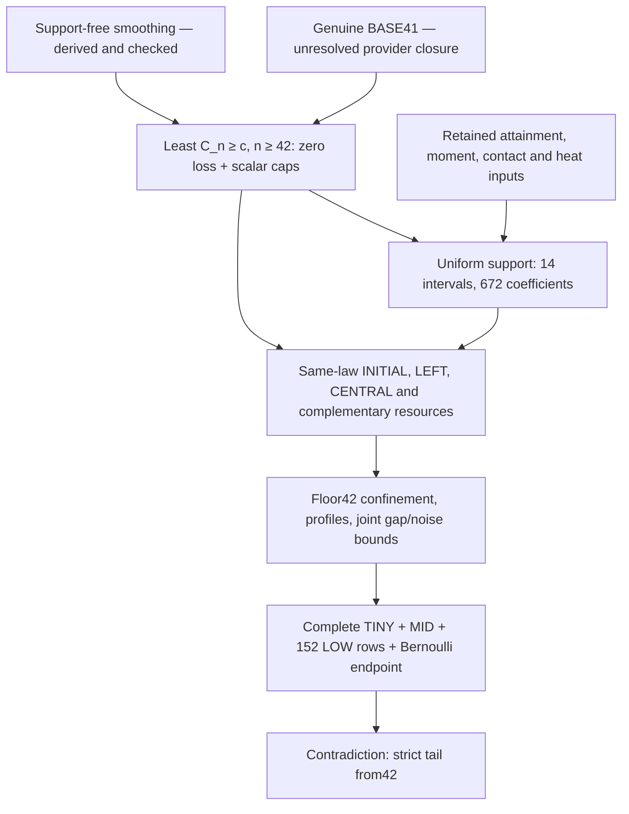

# First-failure redesign: result and review map

Continuation: [further reductions and review](../../reduction2/2026-10-27/README.md)
give an elementary support alternative without Bernstein certificates,
an exact LOW curvature maximum, conditional pruning to150 LOW producers,
and a separate one-pass protocol prototype. The results below remain valid
as the first reduction; all original certificates and proof routes remain.

**The new concrete result is an all-index zero-loss support certificate with
14 closed intervals and672 exact rational coefficients.** It replaces the
old finite42–48 support-sign predicates in a new conditional proof. Combined
with the audited floor42 resource/comparison transfer and a genuine sharp
base through41, it gives a strict tail from42. This is a substantial reduction
of the proposed upper-index dependency graph; it is not a completed proof of
the Berry–Esseen conjecture or a production-runner change.

Reference baseline: `6346fc1b4432bc5982822aa696eb566ed9e1e1ee`, preserved in
`kolodziejek/berry-esseen-certificates` and tagged `audit-baseline-20261027`.
Research started from fork main `2c418e73dc93b0622ab2b4e95ba042201d37604d`.
Independent tasks used separate `simplify/*-20261027` branches/worktrees.
All results are submitted through the existing follow-up draft PR #2; the
original PR #1 was already merged externally before this work. No merge is
performed by this research task.

## Exact new theorem and dependencies

Let `c=(3+sqrt(10))/(6sqrt(2*pi))`. Assume a genuine `C_j<=c` for1..41.
Choose the least `n>=42` with `C_n>=c`, including equality. Both predecessors
are at most c. Support-free Gaussian smoothing gives

    0 <= n(C_n-c) < 3003/10250 < .3,
    C_n < 73/175 < .4226,
    C_(n-1), C_(n-2) <= c < .4253,
    n(C_(n-1)-C_n)_+ = 0.

These supply every scalar gate of the newly named zero-loss uniform LOCAL42
implication. Its contradiction proves `C_n<c` for every n>=42, **conditional
on all its retained analytic and numerical premises**. Choosing the least
strict exceedance would prove only a weak conclusion. The equality-compatible
attainment input remains necessary.



The graph abbreviates the sequential resource/support feedback: each LEFT
contraction first receives moment ceilings from its own preceding resource.
The source-bound table checks every one of those65 support invocations; it
does not acquire their moment ceilings by itself.

## What is proved, checked and still conditional

| Result | Mathematical status | Execution status |
|---|---|---|
| Support-free recurrence and first-failure entry at42 | Locally derived, independently reviewed implication | Fresh exact endpoint/gate checks; prior finite-law diagnostics remain exploratory |
| Uniform support transfer from old finite signs | New proved conditional implication, independently reviewed |130 identities, two splices, both rays, complete bindings; old signs not rerun |
| Direct grouped support alternative | New exact certificate for infinite-index, zero-loss polynomials; analytic reduction/resource premises retained | Fresh672-coefficient PASS on14 intervals, all84 ray signs,9 rejected controls; independent review linked below |
| Other uniform LOCAL42 index transfers | New conditional theorem from named analytic and numeric premises, independently reviewed |34 source pins/interfaces and separate algebraic diagnostics; native numeric predicates not replayed |
| Complete finite42 phase/noise cover and conservative task partition | Exact finite structural result |14,064 rectangle checks, all92 probability rows and152 configurations checked |
| Genuine BASE41 and full global provider graph | Unresolved; current mathematical entry is distinguished from old executable joins | No full finite-base or global acceptance |
| Removal of old certificate files or production tasks | Not performed | Original source/certificate bytes preserved |

## Exactly which work could become unnecessary

[Finite entry](finite-entry.md) lists all31 native task IDs and gives the
reason for each edge removal. [Local cover](local-cover.md) gives the full
finite/tail mapping and its source locations.

- **Six positive-ceiling/support tasks:** `44.entry/accept4044_01`,
  `accept41_01`, `accept4248_01`, `support4044_01`, `support41_01`,
  `support4248_01`. Their scalar bounds are replaced at the first failure by
  the smoothing lemma and sharp predecessors. The distinct zero-barrier
  initial support obligation is retained with its new certificate.
- **Six special43 tasks:** `43.anchor_support01`, `anchor_accept01`,
  `initial_support01`, `scalar01`, `left_fixed01`, `central_fixed01`.
  The forward first-failure argument never enters their backward positive-loss
  bootstrap at actual42. Ordinary LEFT/CENTRAL acquisition remains.
- **All55 separate tail tasks:** only after accepting the complete new
  uniform LOCAL42 theorem, its full local cover replaces the separate LOCAL47
  acquisition/comparison and associated bootstraps. Shared analytic lemmas
  remain inputs; a directory or old theorem is not made globally obsolete.
- **Old finite support-sign subchecks:** the new grouped certificate proves
  the infinite-index zero-loss signs directly. It uses14 single intervals
  for65 bound calls. This does not replace moment acquisition or complete
  LEFT resource acceptance.

The conservative new upper-index plan therefore retains **19 native actions
and152 LOW row producers:171 tasks versus238**, before new joins. The67-task
reduction is conditional and local to this module. It is not a measured time
saving or a claim that lower-base consumers no longer need those sources.
The current240-entry registry also includes two collectors; no unchanged
collector is claimed to accept a reduced parent list.

A further opportunity is duplicate LOW evaluation: the152 producer evaluations
are repeated by the two full native binder replays. The source reports
23,513,686 strict gates in one full set. This is historical workload metadata,
not freshly measured work. The source-only package lacks the reference row
objects, and a one-pass receipt design would change acceptance semantics.
It is documented but not implemented or included in the171-task saving.

## Read and reproduce

- [Compiled proof](proof/main.pdf) and [TeX source](proof/main.tex): scalar
  recurrence, exact conditional theorem, support polynomial definitions,
  group maxima, Bernstein proof and whole-ray continuation.
- [Grouped certificate](grouped-support.md) and
  [fixed checker](check_grouped_support.py): new small arithmetic result.
- [Alternative support lift](zero-loss-support.md): exact finite-to-infinite
  comparison, retaining old signs as an alternative premise.
- [Uniform LOCAL42](uniform42.md): source-by-source analytic interface proof,
  changed floor42 confinement, weighted resources and signed local repairs.
- [Base closure audit](base-closure.md): current40–42 mathematical induction,
  missing current provider body and old tail43-dependent assembly.
- [Independent support review](reviews/support-independent.md),
  [executable review](reviews/executable-independent.md),
  [uniform-transfer review](reviews/uniform-independent.md),
  [grouped-certificate review](reviews/grouped-independent.md), and
  [composition review](reviews/composition-independent.md).

From repository root, run each new checker under ordinary unoptimized Python:

```sh
python3 -B mathematics/simplification/2026-10-27/check_grouped_support.py
python3 -B mathematics/simplification/2026-10-27/check_support_lift.py
python3 -B mathematics/simplification/2026-10-27/check_finite_entry.py
python3 -B mathematics/simplification/2026-10-27/check_uniform42_interfaces.py
python3 -B mathematics/simplification/2026-10-27/check_local_cover_inventory.py
```

The grouped checker imports the new binding helper from the same directory;
`-I` excludes that directory, so use the displayed invocation for that script.
The other checks are standalone. Receipts under `runs/` record actual commands,
input hashes, interpreter versions, return codes and limitations. No inherited
program was imported/executed and no heavy certificate campaign was launched.

## Remaining barriers and merge scope

The missing pinned `current4042_low_mathematical_assembly_v2.py` and the full
sharp38/39 providers must be inspected before claiming independent BASE41
closure. The older62F assembly explicitly consumes tail43/early/single39;
the current mathematical A17 contract has different parents. A source hash
cannot decide which implementation graph is valid.

All original contact/attainment, Fourier, moment, normalization and strict
Bernoulli dependencies remain at their audited status. The retained local
numerical predicates need acceptance at their exact original targets. A
separately named new composition contract must bind the base, equality entry,
new support certificate and complete local premises; the old wrappers still
have their original finite scope. No script here emits a whole-proof PASS.

The intended merge scope is **reviewed conditional research and its small
exact certificate**, preserving the production proof and all old certificates.
It is not approval to remove proof components or claim the conjecture. The
review outcome and recommendation are recorded in the draft PR description;
merging still requires the user's explicit approval.
